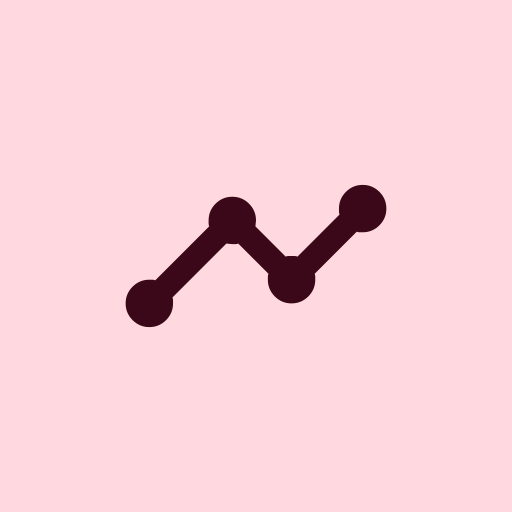
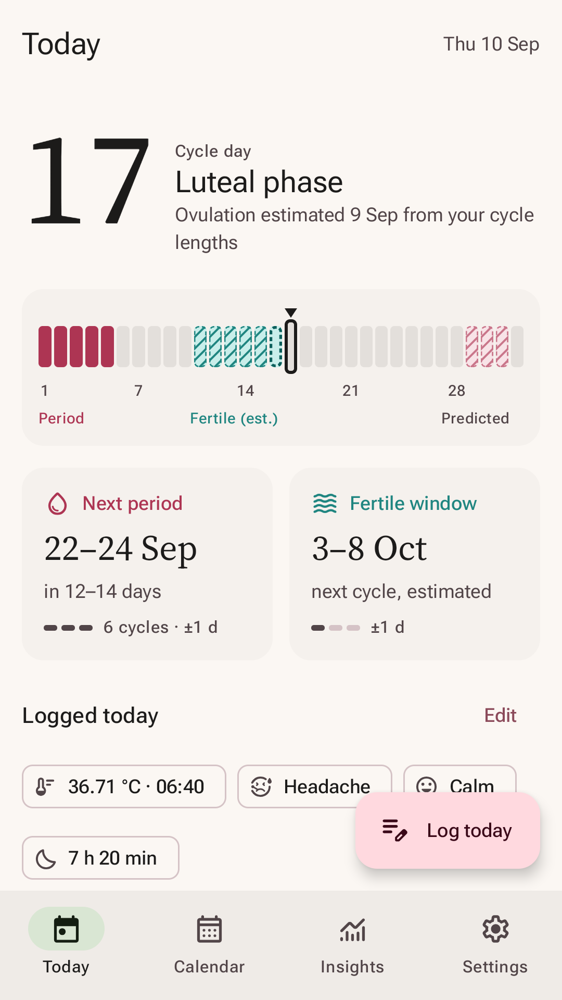
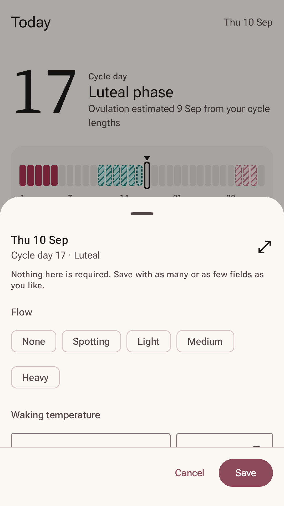
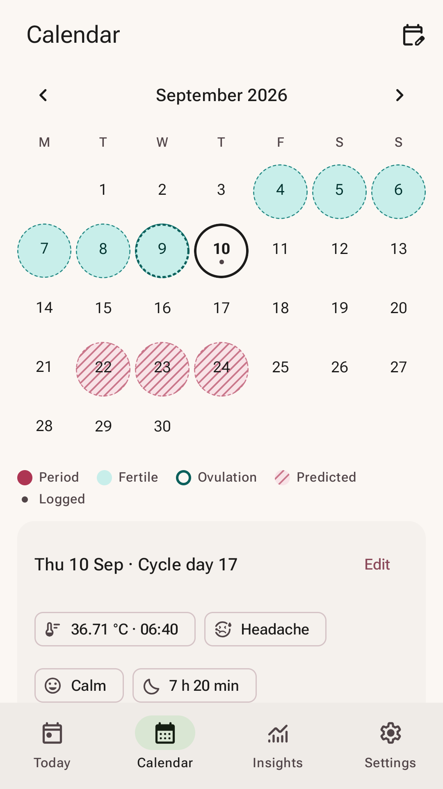
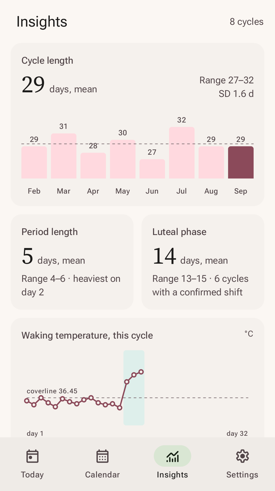
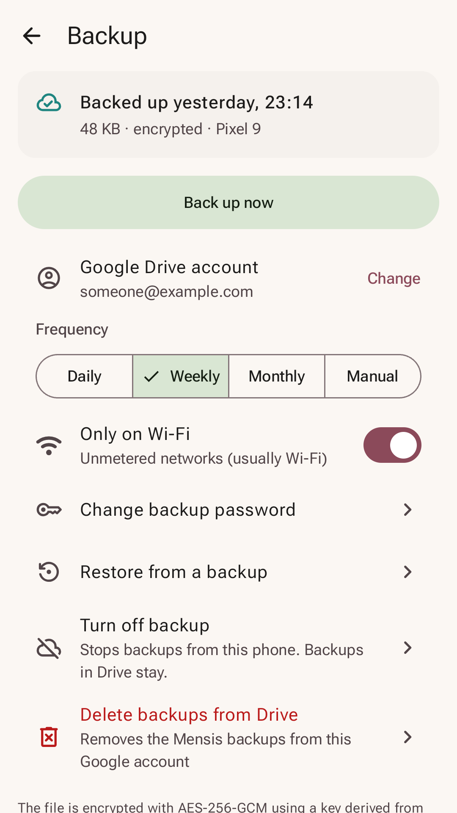
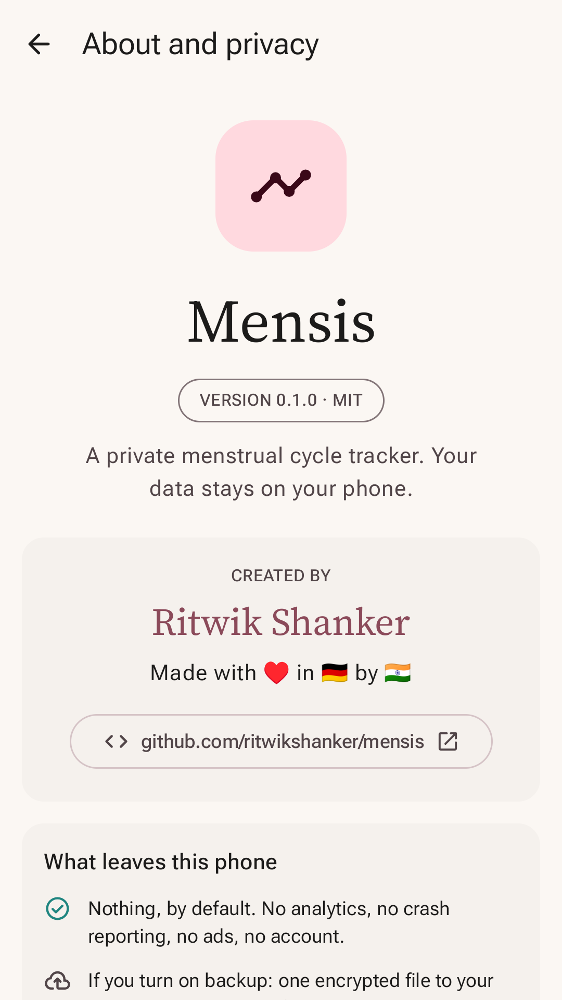
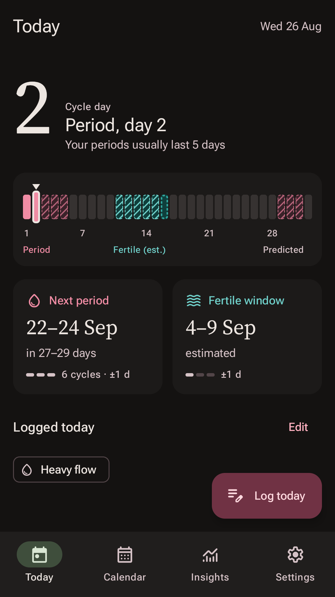

<p align="center">
  
</p>

<h1 align="center">Mensis</h1>

<p align="center">
  <b>A cycle tracker that keeps your data on your phone.</b><br>
  No account · no analytics · no ads · open source under the MIT licence
</p>

<p align="center">
  <a href="#join-the-test"><b>Join the test on Google Play</b></a> ·
  <a href="https://ritwikshanker.github.io/mensis/privacy/">Privacy policy</a> ·
  <a href="https://github.com/ritwikshanker/mensis/issues">Report a problem</a>
</p>

<p align="center">
  
  
  
  
</p>

## Join the test

Mensis is in a closed test on Google Play, and every tester counts: Google Play lets a new app go public
only after at least 12 testers have stayed in its test for 14 days in a row. You need an Android phone
(Android 8 or newer) with Google Play, and the same Google account in every step.

**Invited by e-mail?** Your Google account is already on the test, so it takes two steps:

1. **Become a tester:** <https://play.google.com/apps/testing/com.deutschdreamers.mensis>, then
   *Become a tester*.
2. **Install Mensis:** <https://play.google.com/store/apps/details?id=com.deutschdreamers.mensis> (this
   page only opens once you are a tester), or use the Google Play link on the page from step 1. Updates
   arrive through Google Play like any other app.

**Not invited?** Ask to join first:

1. **Join the testers group:** <https://groups.google.com/g/mensis-testers>, then *Join group*. The
   group is only the sign-up list: the developer adds its members to the test by hand, usually within a
   day. Only the developer can see members' addresses, and the group sends no messages.
2. A day later, do the two steps above.

Then please **stay in the test for at least 14 days**, ideally with Mensis installed. Testers who leave
earlier do not count towards the 12.

If something does not work:

- *The page says the test is not available, or there is no Become a tester button:* check that the
  page uses the Google account you were invited with or that joined the group (switch accounts with the
  profile picture at the top right). If you joined the group, you may not have been added yet; try
  again the next day.
- *The Play Store says Mensis is not available:* in the Play Store app, tap your profile picture and
  switch to the account that joined the test.

Know someone with an Android phone who might like Mensis? Send them
<https://ritwikshanker.github.io/mensis/#join-the-test>.

Good to know while testing:

- Your data stays on your phone. Uninstalling Mensis deletes it, so turn on backup or export your data
  before you uninstall or switch phones.
- Found a bug or have an idea? Open an [issue on GitHub](https://github.com/ritwikshanker/mensis/issues)
  or use the contact e-mail on the Google Play page. Please do not include real cycle data in reports.
- You can leave the test at any time on the page where you became a tester.

## What it does

Mensis is a menstrual cycle tracker for Android that works entirely on your phone. You log what you
want, when you want; Mensis turns it into ranges and charts without sending it anywhere.

- **Log as much or as little as you like.** Period days and flow, symptoms, mood, sleep and notes. Add
  waking temperature, cervical mucus and LH tests if you follow the sympto-thermal method, pregnancy
  tests, and your contraception: pill, patch, ring, injection, implant or IUD. Nothing is ever required.
- **Ranges, not guesses.** After one complete cycle Mensis estimates your next period as a date range
  and tells you how many cycles that rests on. After three cycles it adds an estimated fertile window
  and shows how much your cycles vary. A waking temperature shift marks ovulation after the fact;
  without temperatures, ovulation is estimated from your cycle lengths and labelled as such.
- **Understands hormonal methods.** With a cyclic pill, patch or ring Mensis counts your pack days and
  predicts the withdrawal bleed. With a hormonal IUD, periods and ovulation often continue, so predictions
  follow the periods you log. With methods that usually stop the cycle, such as the implant or continuous
  use, it pauses predictions.
- **Insights.** Cycle and period lengths, luteal phase, temperature charts and symptoms that come back
  in the same phase of your cycle.
- **A report for your doctor.** A PDF with your cycle statistics and charts, created on the phone.
- **Discreet reminders.** Period, fertile window, contraception and temperature reminders are scheduled
  on the phone. Notifications say only "Reminder" unless you choose other wording.
- **Pregnancy mode** with the estimated due date and week.
- **Your data stays yours.** Export to JSON or CSV, with optional password encryption. Import from a
  Mensis export, from drip. or from any CSV file; Clue import is experimental.
- **Light and dark**, two colour schemes, and Material You colours on Android 12 and later.

<p align="center">
  
  
  
</p>

## Private by design

- **Encrypted on the phone.** Everything you log is stored in an encrypted database. Its key is
  protected by the phone's Android Keystore, so the database can only be read on that phone.
- **No servers of ours.** There is no account and no Mensis server. Mensis sends your data nowhere
  unless you turn on Google Drive backup.
- **Backup only you can read.** The optional backup is encrypted on the phone with a password only you
  know, then stored in a hidden app folder in your own Google Drive. Google cannot read it, and neither
  can the developer. There is no password reset.
- **Nothing to track you.** No analytics, crash reporting, ads or tracking libraries in the code. The
  only Google libraries are the ones needed for sign-in and Drive.
- **Quiet on screen.** Optional app lock with your fingerprint, face or screen lock. Screenshots and the
  preview in recent apps are blocked by default.

The full threat model is in [PRIVACY.md](PRIVACY.md), the privacy policy at
<https://ritwikshanker.github.io/mensis/privacy/>.

## Important

Predictions are statistics about your own history. Mensis is not a medical device and does not
diagnose, treat, cure or prevent any medical condition. It is not a method of contraception. Please
consult a healthcare professional about any question concerning your health.

## Build it yourself

Mensis is written in Kotlin with Jetpack Compose. With JDK 17 or newer and the Android SDK:

```
./gradlew assembleDebug
```

Builds from source work without Google Play services; only Drive backup is then unavailable.
[CONTRIBUTING.md](CONTRIBUTING.md) covers building, tests, the project layout and how to contribute.

## Licence

MIT, see [LICENSE](LICENSE). Fonts, icons and libraries are listed with their licences in
[THIRD_PARTY_NOTICES.md](THIRD_PARTY_NOTICES.md).
